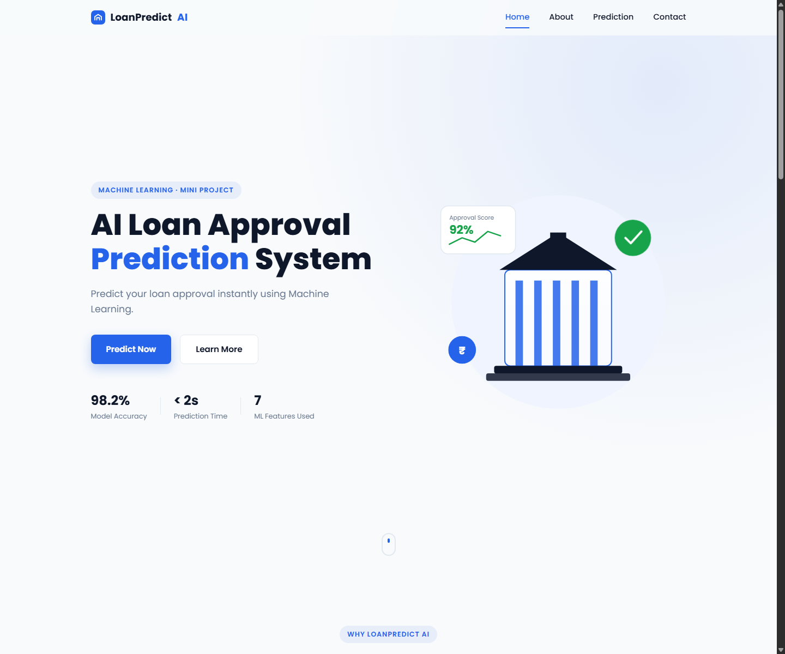

# Loan Approval Prediction System

A Flask web app that predicts a loan application's outcome from applicant details and provides a credit score based bank match for supported loan products.

## Current UI



## Features

- Loan approval prediction with model confidence when available.
- Interactive applicant form with completion progress and example applicant presets.
- Credit score meter with a simple score range indicator.
- Live EMI, total repayment, and interest estimates. The default illustrative rate is 9%; users can adjust it from 5% to 25%.
- Home loan bank matches based on published credit score rules.
- Responsive layout and inline form validation.
- Collateral value is no longer requested. The backend supplies zero for this model input to preserve compatibility with the saved model.
- Footer contact links currently contain sample values (`hello@example.com` and `+91 00000 00000`); replace them with real contact details before publishing.

## Bank credit score matching

The bank count is a score screen only, not an approval or complete eligibility assessment. Current home loan rules are:

| Bank | Published score rule used by this app |
| --- | --- |
| State Bank of India (SBI) | Scores below 550 are ineligible for the published home loan policy. |
| Punjab National Bank (PNB) | The housing loan FAQ says no minimum CIC score is prescribed. |

The app links to each bank's official source in the prediction result. For car, education, and personal loans, it reports that no verified bank score rules are configured rather than reusing home loan rules. Bank terms can change; confirm criteria with the lender before applying.

## Tech stack

- Python 3.11, Flask, and scikit-learn
- HTML, CSS, and JavaScript
- Saved model, scaler, and one-hot encoder in `model/`

## Run locally

```bash
python -m pip install -r requirements.txt
python app.py
```

Open [http://127.0.0.1:5000](http://127.0.0.1:5000). The health endpoint is available at `/health`.

## Project structure

```text
app.py                 Flask API and prediction pipeline
dataset/               Loan approval training dataset
model/                 Saved model and preprocessing artifacts
notebook/              Model exploration and training notebook
screenshots/           Application screenshots
static/                CSS and JavaScript
templates/             Flask HTML template
```

## Model artifact compatibility

The checked-in model artifacts were saved with scikit-learn 1.6.1, and `requirements.txt` pins that matching version.

## Deployment

The repository includes a `Procfile` for a WSGI deployment using Gunicorn and a `.python-version` file selecting Python 3.11.9. On Render, create a Python web service for the `main` branch with build command `pip install -r requirements.txt` and start command `gunicorn app:app`. The checked-in model files and dependencies are included in the repository.

## License

This project is developed for educational purposes.
