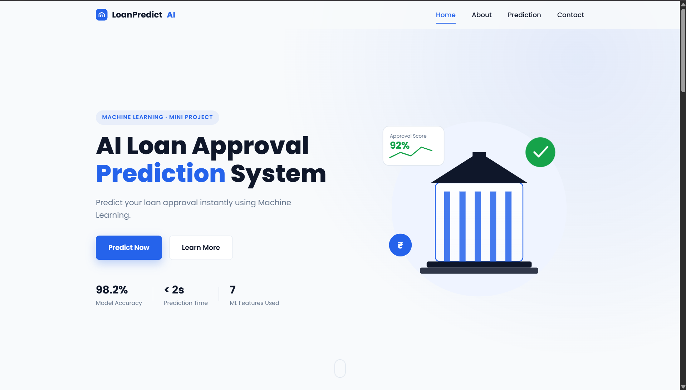
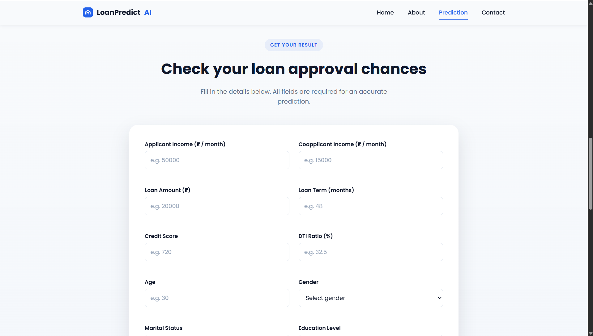
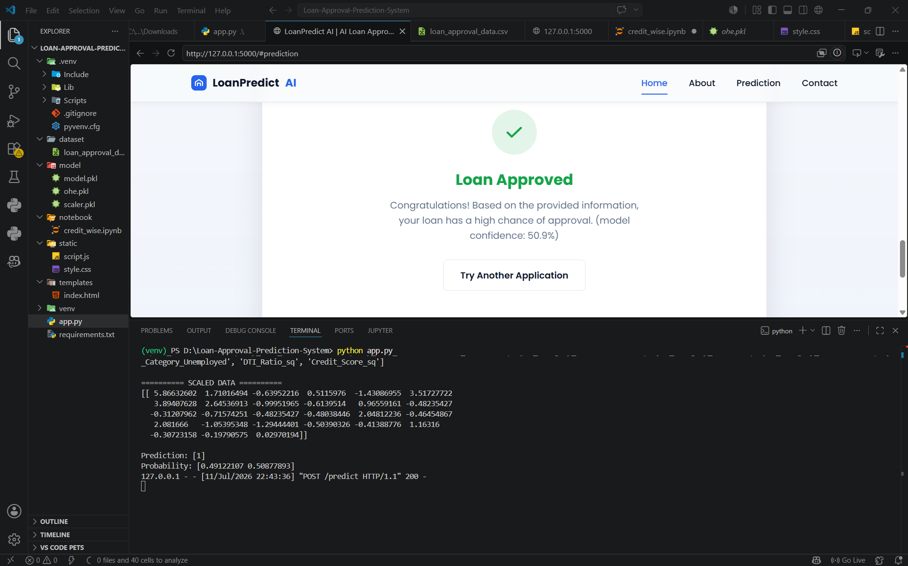
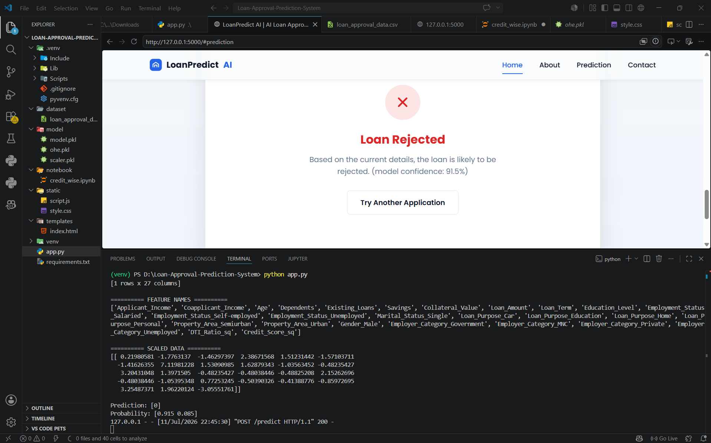
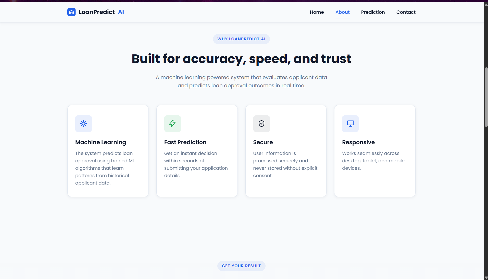

# Loan Approval Prediction System

A Machine Learning based Loan Approval Prediction System built using Flask, HTML, CSS, JavaScript, and Scikit-learn.

## Features

- Predicts whether a loan application will be Approved or Rejected
- Beautiful responsive UI
- Real-time prediction using Machine Learning
- Confidence score display
- Home-loan bank matches based on published credit-score criteria
- Form validation
- Flask backend

## Tech Stack

- Python
- Flask
- Scikit-learn
- Random Forest Classifier
- HTML
- CSS
- JavaScript

## Bank credit-score matching

After a prediction, the result card shows the count of banks whose published
credit-score screen matches the applicant's score for a home loan. The current
rules are based on SBI's published home-loan score bands (scores below 550 are
not eligible) and PNB's housing-loan FAQ (no minimum CIC score prescribed).
Each bank entry links to its source. For car, education, and personal loans the
app reports that it has no verified rules yet; it does not reuse home-loan
criteria for another product.

This is a credit-score screen only. It is not an approval, and each lender also
checks income, repayment capacity, documents, product terms, and other factors.
Bank rules can change, so check the linked bank page before applying.

## Machine Learning

Model Used:
- Random Forest Classifier

Performance:

- Accuracy: 90%
- Precision: 82.5%
- Recall: 85.2%
- F1 Score: 83.9%

## Project Structure

```
Loan-Approval-Prediction-System/
│
├── app.py
├── requirements.txt
├── README.md
│
├── dataset/
├── model/
├── notebook/
├── static/
│   ├── style.css
│   └── script.js
│
└── templates/
    └── index.html
```

## Screenshots

### Home


### Prediction Form


### Loan Approved


### Loan Rejected


### About


## Installation

Clone the repository

```bash
git clone https://github.com/adarsh-jayswal/Loan-Approval-Prediction-System.git
```

Install dependencies

```bash
pip install -r requirements.txt
```

Run the application

```bash
python app.py
```

Open

```
http://127.0.0.1:5000
## Deployment

### Deploying to Render / Heroku / Railway

1. Push your repository to GitHub.
2. Create a new **Web Service** on Render/Heroku/Railway connected to your GitHub repository.
3. Configure settings:
   - **Build Command**: `pip install -r requirements.txt`
   - **Start Command**: `gunicorn app:app`
   - **Python Version**: Python 3.11.x (configured via `runtime.txt`)
4. Set Environment Variables (Optional):
   - `PORT`: (automatically set by hosting platform)
   - `FLASK_DEBUG`: `False`
   - `CORS_ORIGINS`: `*`

### Running with Production WSGI Server (Gunicorn)

```bash
gunicorn app:app
```

## License

This project is developed for educational purposes.
